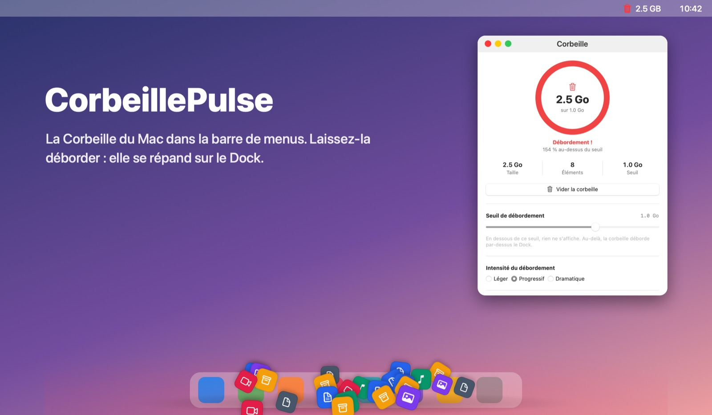

# CorbeillePulse



**La Corbeille du Mac dans la barre de menus. Laissez-la déborder : elle se répand sur le Dock.**

CorbeillePulse est une petite app macOS native. Elle surveille la Corbeille et montre à quel point elle est pleine. Vous choisissez une taille limite : au-delà, l'icône de la barre de menus passe au rouge et un tas de fichiers grandit par-dessus le Dock, d'autant plus que la limite est dépassée.

*[English version](README.md)*

## Télécharger

**[Télécharger la dernière version (DMG)](https://gitlab.com/northerntech1/mac-apps/corbeillepulse/-/releases/permalink/latest/downloads/CorbeillePulse.dmg)**

Il faut macOS 14 (Sonoma) ou plus récent, sur Apple Silicon ou Intel. Rien d'autre à installer.

1. Ouvrez le DMG et glissez CorbeillePulse dans Applications.
2. Ouvrez-la. macOS la bloque la première fois, car elle n'est pas notariée par Apple : allez dans **Réglages Système › Confidentialité et sécurité** et cliquez sur **Ouvrir quand même**.
3. Autorisez l'accès à Finder quand macOS le demande : c'est ce qui permet de lire la Corbeille.

## Fonctions

- **Icône de barre de menus :** corbeille vide, pleine, ou rouge avec la taille quand elle déborde. Son menu ouvre l'app ou vide la Corbeille.
- **Panneau de contrôle :** jauge de remplissage, taille, nombre d'éléments et plus gros éléments de la Corbeille.
- **Votre limite :** de 1 Mo à 50 Go, 100 Mo par défaut.
- **Trois styles de débordement :** Léger, Progressif ou Dramatique.
- **Bouton Vider la corbeille,** avec une confirmation où Entrée annule.
- **Français et anglais,** selon la langue du Mac.

Le tas est dessiné dans une fenêtre transparente qui laisse passer tous les clics vers le Dock et les fenêtres en dessous. Elle n'est à l'écran que pendant un débordement.

## Confidentialité et autorisations

macOS protège la Corbeille. L'app la lit donc de l'une de ces deux façons :

- **Via le Finder** (par défaut) : il faut une autorisation d'Automatisation, une seule fois. Le Finder ne donne pas la taille des dossiers : ceux qui sont dans la Corbeille ne sont pas comptés dans le total.
- **Directement**, si vous accordez à CorbeillePulse **l'accès complet au disque** : le total est exact, dossiers compris.

L'app ne se connecte à rien et ne collecte rien.

## Compiler

Il faut Xcode 16 ou plus récent.

```sh
swift test                      # tests (CP_LIVE=1 lit aussi la vraie Corbeille, sans la modifier)
scripts/check-localization.sh   # chaque texte a sa traduction anglaise
scripts/build-app.sh            # dist/CorbeillePulse.app, universelle, signature ad hoc
scripts/make-dmg.sh             # dist/CorbeillePulse-<version>.dmg
```

`scripts/release.sh` publie une nouvelle version sur GitLab et GitHub.

---

Réalisé par [Northern Tech](https://northerntech.fr). Le dépôt principal est sur [GitLab](https://gitlab.com/northerntech1/mac-apps/corbeillepulse), avec une copie sur [GitHub](https://github.com/vince749/corbeillepulse).
