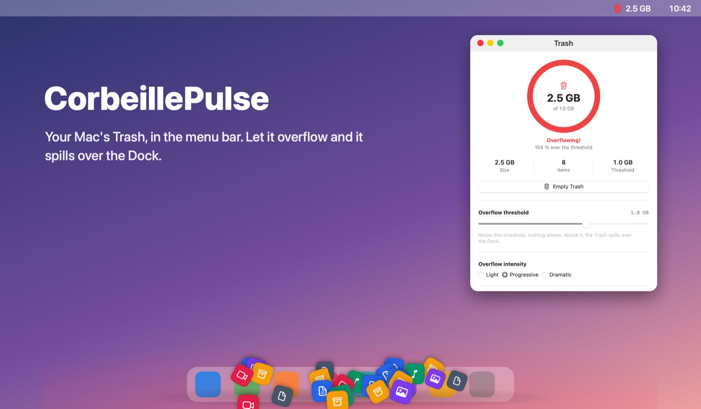

# CorbeillePulse



**Your Mac's Trash, in the menu bar. Let it overflow and it spills over the Dock.**

CorbeillePulse is a small native macOS app. It watches your Trash and shows how full it is. Pick a size limit: once the Trash goes past it, the menu bar icon turns red and a pile of files starts to build up over the Dock. The further past the limit, the bigger the pile.

*[Version française](README.fr.md)*

## Download

**[Download the latest version (DMG)](https://gitlab.com/northerntech1/mac-apps/corbeillepulse/-/releases/permalink/latest/downloads/CorbeillePulse.dmg)**

Requires macOS 14 (Sonoma) or later, on Apple Silicon or Intel. Nothing else to install.

1. Open the DMG and drag CorbeillePulse into Applications.
2. Open it. macOS blocks it the first time, because it is not notarized by Apple: go to **System Settings › Privacy & Security** and click **Open Anyway**.
3. Allow access to Finder when macOS asks. This is how the app reads the Trash.

## Features

- **Menu bar icon:** an empty bin, a full bin, or a red bin with the size once the Trash overflows. Its menu opens the app or empties the Trash.
- **Control panel:** a fill gauge, the size and number of items, and the largest items in the Trash.
- **Your own limit:** from 1 MB to 50 GB, 100 MB by default.
- **Three overflow styles:** Light, Progressive or Dramatic.
- **Empty Trash** button, with a confirmation that defaults to Cancel.
- **English and French,** following your Mac's language.

The pile is drawn in a transparent window that lets every click through to the Dock and the windows below. It is only on screen while the Trash overflows.

## Privacy and permissions

macOS protects the Trash, so the app reads it in one of two ways:

- **Through Finder** (the default): it needs a one-time Automation approval. Finder does not report folder sizes, so folders in the Trash are not counted in the total.
- **Directly**, if you give CorbeillePulse **Full Disk Access**: the total is exact, folders included.

The app makes no network connections and collects nothing.

## Build from source

Requires Xcode 16 or later.

```sh
swift test                      # unit tests (CP_LIVE=1 also reads the real Trash, read-only)
scripts/check-localization.sh   # every string has an English translation
scripts/build-app.sh            # dist/CorbeillePulse.app, universal, ad hoc signed
scripts/make-dmg.sh             # dist/CorbeillePulse-<version>.dmg
```

`scripts/release.sh` publishes a new version to GitLab and GitHub.

---

Made by [Northern Tech](https://northerntech.fr). The main repository is on [GitLab](https://gitlab.com/northerntech1/mac-apps/corbeillepulse), with a copy on [GitHub](https://github.com/vince749/corbeillepulse).
